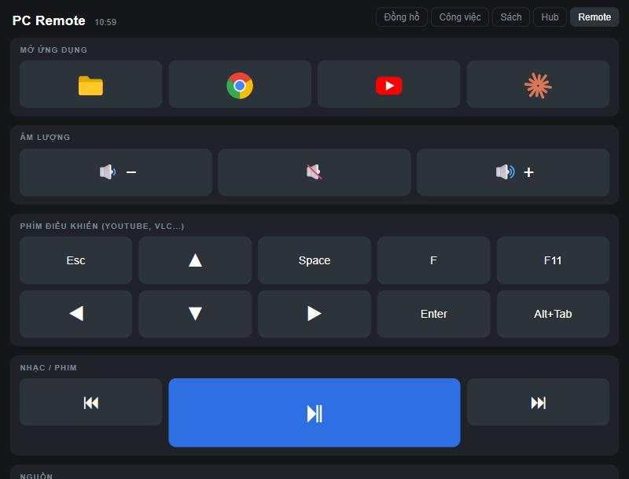
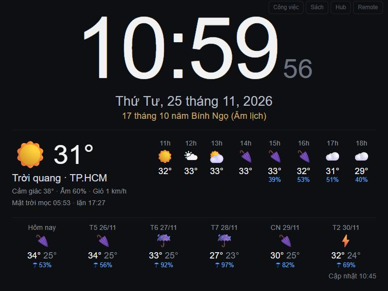
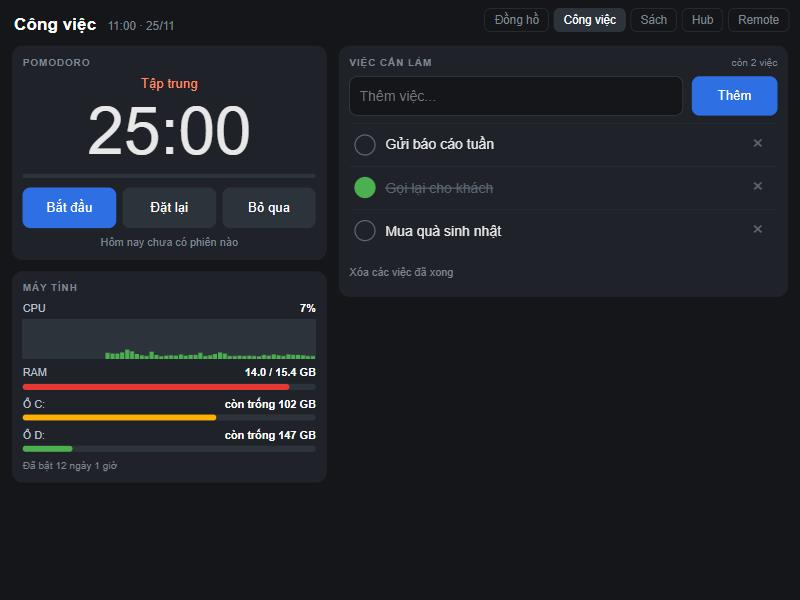
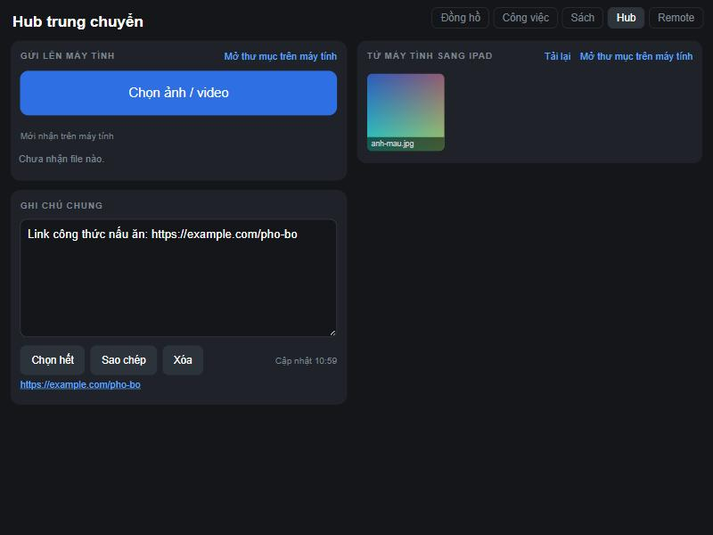
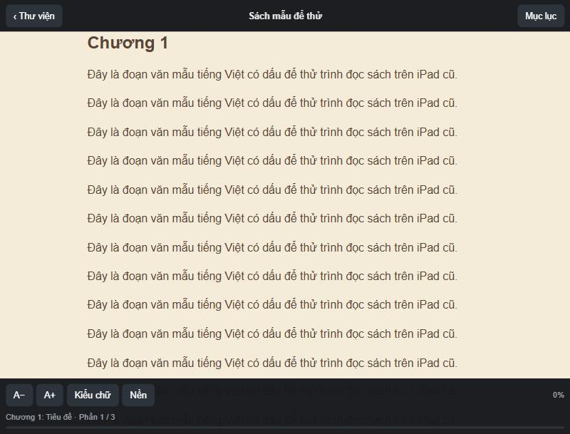

# iPad cũ Hub

Biến một chiếc iPad đời cũ (iOS 9, Safari 9) thành **màn hình phụ hữu ích trong nhà**. Máy tính Windows làm server, iPad chỉ việc mở trang web trong mạng Wi-Fi nhà mình.

Vì sao cần cách này: web và app bây giờ không còn chạy trên iOS 9 (JavaScript mới, chứng chỉ HTTPS mới). Dự án này viết toàn bộ giao diện theo chuẩn cũ (ES5, HTTP trong mạng LAN), nên Safari 9 vẫn chạy mượt.

| Trang | Địa chỉ | Làm được gì |
|---|---|---|
| Remote | `/` | Điều khiển máy tính: nhạc/phim, âm lượng, phím mũi tên, mở app, khóa/ngủ/tắt máy |
| Đồng hồ | `/clock` | Đồng hồ lớn, ngày âm lịch, thời tiết theo giờ và 6 ngày (Open-Meteo, miễn phí) |
| Công việc | `/work` | Pomodoro, CPU/RAM/ổ đĩa của máy tính, danh sách việc cần làm |
| Sách | `/books` | Đọc EPUB và PDF, nhớ trang đang đọc, đổi cỡ chữ, đổi nền |
| Hub | `/hub` | Gửi ảnh/video từ iPad lên máy tính, lấy ảnh từ máy tính về iPad, ghi chú dùng chung |

| Remote | Đồng hồ |
|---|---|
|  |  |
| **Công việc** | **Hub** |
|  |  |



---

## Cần có

- Máy tính **Windows 10/11** cùng mạng Wi-Fi với iPad.
- **Python 3.10 trở lên** ([python.org](https://www.python.org/downloads/)). Lúc cài, nhớ tích **"Add python.exe to PATH"**.
- iPad hoặc iPhone đời cũ chạy Safari (đã thử trên iOS 9). Máy mới hơn cũng dùng được.
- Tùy chọn: **PyMuPDF**, để đọc PDF ngay trong trình đọc (có nhớ trang, mục lục). Không cài thì PDF mở bằng Safari.

## Cài đặt (khoảng 5 phút)

1. **Tải mã nguồn**: bấm nút xanh **Code → Download ZIP** trên trang GitHub này, rồi giải nén ra một thư mục, ví dụ `D:\ipad-cu-hub`.
2. **(Tùy chọn) Cài PyMuPDF để đọc PDF tốt hơn**. Mở PowerShell và chạy:
   ```powershell
   python -m pip install pymupdf
   ```
3. **Chạy thử**: bấm đúp `start.bat`. Cửa sổ đen sẽ hiện ra như sau:
   ```
    PC Remote dang chay
    Mo tren iPad:  http://192.168.1.10:8765
    Ma PIN:        4821
   ```
   Lần chạy đầu, server tự tạo file `config.json` với một **mã PIN ngẫu nhiên**.
4. **Mở cổng firewall** (chỉ làm một lần). Mở PowerShell bằng **Run as Administrator** rồi chạy lệnh dưới. Lệnh này chỉ cho các máy trong mạng nhà vào cổng 8765:
   ```powershell
   New-NetFirewallRule -DisplayName "iPad cu Hub 8765" -Direction Inbound -Protocol TCP -LocalPort 8765 -RemoteAddress LocalSubnet -Action Allow
   ```
5. **Mở trên iPad**: vào Safari, gõ địa chỉ hiện trong cửa sổ đen, nhập mã PIN (iPad sẽ nhớ PIN).
   Bấm **Chia sẻ → Thêm vào MH chính** để mở toàn màn hình như một app.
6. **Để làm màn hình cố định trên iPad**: vào *Cài đặt → Màn hình & Độ sáng → Khóa tự động → Không bao giờ*, rồi cắm sạc.

## Chạy ngầm và tự bật cùng Windows

- `start-hidden.vbs`: chạy server ngầm, không hiện cửa sổ. Địa chỉ và PIN được ghi vào file `server.log`.
- `stop.bat`: tắt server đang chạy ngầm.
- **Tự bật khi mở máy**: nhấn `Win + R`, gõ `shell:startup`, Enter. Chuột phải `start-hidden.vbs` → *Create shortcut*, rồi kéo shortcut vừa tạo vào thư mục Startup đó.
  Lưu ý: kéo **shortcut** vào, đừng copy file gốc.

## Cách dùng từng trang

### Remote
- **Mở ứng dụng**: các nút icon (File Explorer, Chrome, YouTube, Claude), đổi được trong `config.json`.
- **Âm lượng và phím mũi tên**: bấm giữ để lặp liên tục.
- **Tắt máy / Restart**: hẹn sau 60 giây. Bấm **Hủy tắt** nếu lỡ tay.

### Đồng hồ
- Không cần PIN. Có ngày âm lịch (tô đậm Mùng 1 và Rằm), thời tiết hiện tại, 8 giờ tới và 6 ngày tới.
- Từ 22h đến 6h màn hình tự tối bớt cho dịu mắt.

### Công việc
- **Pomodoro**: tập trung 25 phút, nghỉ ngắn 5 phút, cứ 4 phiên thì nghỉ dài 15 phút. Hết giờ thì iPad kêu bíp (phải bấm "Bắt đầu" trên trang thì iOS mới cho phát tiếng).
- **Máy tính**: biểu đồ CPU 60 giây, RAM, dung lượng trống các ổ đĩa.
- **Việc cần làm**: lưu trên máy tính (`todos.json`), nên tắt mở lại không mất.

### Sách
- Chép file `.epub` hoặc `.pdf` vào thư mục `books`, rồi tải lại trang Sách.
- **Lật trang**: chạm bên phải là trang sau, bên trái là trang trước. **Chạm giữa màn hình** để mở menu: mục lục, cỡ chữ, kiểu chữ, nền tối / vàng giấy / trắng.
- Vị trí đọc được lưu trên máy tính, mở lại là đọc tiếp đúng chỗ cũ.

### Hub
- **iPad → máy tính**: bấm *Chọn ảnh / video*, xem lại ảnh đã chọn (bấm **×** để bỏ ảnh chọn nhầm), rồi bấm **Gửi**. File lưu vào `inbox\<ngày>\`.
- **Máy tính → iPad**: chép file vào `outbox`. Trên iPad, bấm vào ảnh để xem lớn, rồi **nhấn giữ → Lưu hình ảnh**.
- **Ghi chú chung**: dán chữ hoặc link ở một bên, bên kia thấy sau khoảng 3 giây. Trên máy tính mở `http://localhost:8765/hub` để dùng chung.
- Giới hạn của iOS 9: chỉ chọn được ảnh/video trong Thư viện ảnh, và video sẽ bị iOS nén lại. Muốn lấy bản gốc thì cắm cáp, vào *File Explorer → Apple iPad → DCIM*.

## Tùy chỉnh `config.json`

Sửa xong thì chạy lại server (`stop.bat` rồi `start-hidden.vbs`). Xem mẫu đầy đủ trong `config.example.json`.

| Mục | Ý nghĩa |
|---|---|
| `pin` | Mã PIN để vào Remote, Công việc, Sách, Hub |
| `port` | Cổng (mặc định 8765). Đổi cổng thì nhớ sửa luật firewall theo |
| `apps` | Các nút mở ứng dụng: `name`, `icon` (`explorer` / `chrome` / `youtube` / `claude`, để trống thì hiện chữ), `cmd` (lệnh Windows) |
| `weather` | Tên thành phố, `lat`, `lon`, `timezone` cho phần thời tiết |
| `library` | Danh sách thư mục chứa sách, ví dụ `["books", "D:\\Ebooks"]` |
| `hub` | Thư mục `inbox` / `outbox` của Hub |

## Gỡ lỗi nhanh

| Hiện tượng | Cách xử lý |
|---|---|
| iPad không vào được | Kiểm tra máy tính và iPad cùng Wi-Fi, rồi chạy lệnh firewall ở bước 4. Router có thể cấp IP mới cho máy tính, nên xem lại địa chỉ trong `server.log` |
| Quên mã PIN | Xem trong `config.json` hoặc `server.log` |
| Bấm `start.bat` báo "Cong 8765 dang duoc dung" | Server đang chạy ngầm rồi. Chạy `stop.bat` trước nếu muốn chạy lại |
| PDF mở bằng Safari, không nhớ trang | Cài PyMuPDF (bước 2) rồi chạy lại server |

## Bảo mật

- Server chỉ dành cho **mạng nhà tin cậy**, không có HTTPS. Đừng mở cổng này ra Internet.
- Các trang điều khiển máy và dữ liệu cá nhân đều cần mã PIN. Riêng trang Đồng hồ không cần.
- Các nút mở ứng dụng chỉ chạy những lệnh có sẵn trong `config.json`, iPad không gửi lệnh tùy ý được.

## Cấu trúc thư mục

```
server.py         server chính (chỉ dùng thư viện có sẵn của Python)
books.py          đọc EPUB / PDF
hub.py            trung chuyển file + ghi chú
*.html            giao diện cho Safari 9 (ES5, không dùng thư viện ngoài)
start.bat         chạy có cửa sổ
start-hidden.vbs  chạy ngầm
stop.bat          tắt server chạy ngầm
config.example.json   mẫu cấu hình
```

Những file sau được tạo lúc chạy và **không đưa lên GitHub**: `config.json`, `todos.json`, `positions.json`, `hub_note.json`, `server.log`, và các thư mục `books/`, `inbox/`, `outbox/`.
